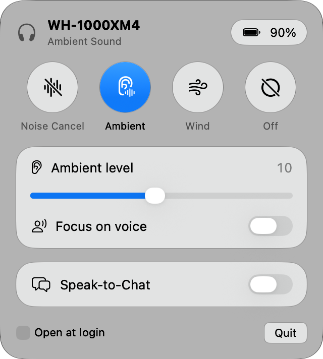
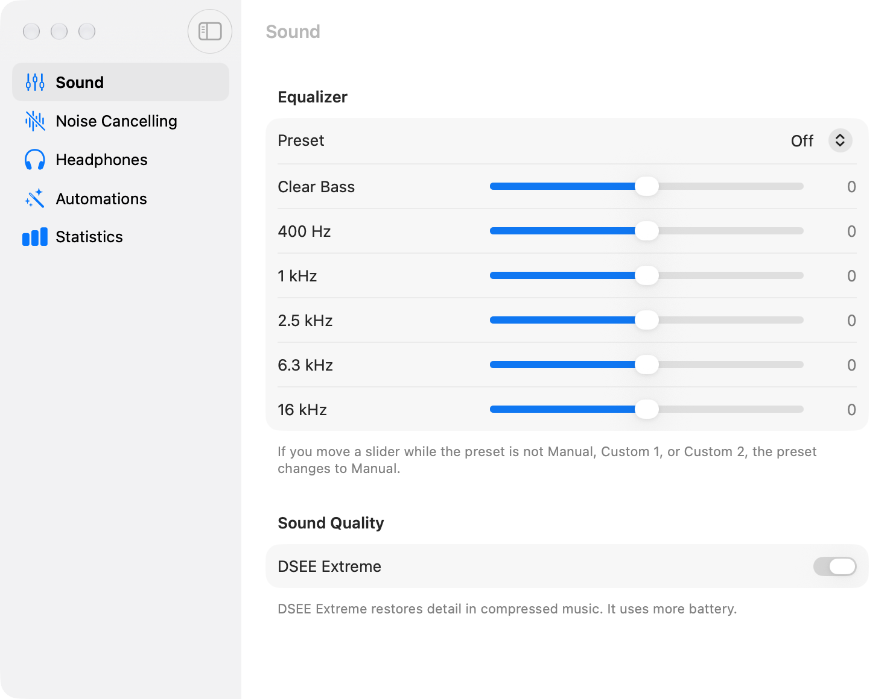

# Sony Control

Sony Control is a macOS menu bar app for Sony WH-1000XM4 headphones. It replaces the Sony phone app for daily settings.



## Features

In the menu bar panel:

- Noise cancelling, ambient sound, wind noise reduction, and off
- Ambient sound level (1–20) and focus on voice
- Speak-to-Chat on and off
- Battery level
- Live updates when you push the NC/AMB button on the headphones

In the **Advanced** window (click **Advanced…** in the panel):

- **Sound:** equalizer presets, Clear Bass, 5-band equalizer, and DSEE Extreme
- **Noise Cancelling:** the noise cancelling optimizer, and the Speak-to-Chat settings (voice detection, end after silence, focus on voice)
- **Headphones:** pause when taken off, voice guidance, model, firmware, codec, and a button to turn off the headphones
- **Automations:**
  - Ambient sound during calls: when an app uses the microphone, the headphones change to ambient sound. After the call, they change back.
  - A global keyboard shortcut (⌃⌥⌘N) that cycles the modes
  - Battery level in the menu bar, and a notification when the battery is low
- **Statistics:** the lifetime usage counters that the headphones keep, for example power-ons, play presses, and Quick Attention uses



## Requirements

- macOS 26 or later, on a Mac with Apple silicon or Intel
- Sony headphones that use the first Sony control protocol. This app was tested with WH-1000XM4 (firmware 2.9.0). WH-1000XM3 will probably work. WH-1000XM5 and newer models use a different protocol and do not work.

## Install

1. Open Terminal.
2. Paste this command, then push Return:

   ```sh
   curl -fsSL https://raw.githubusercontent.com/johanovskyt/sony-control/main/install.sh | sh
   ```

3. Click the headphones icon in the menu bar.
4. If macOS asks for Bluetooth access, click **Allow**.

The command downloads the latest release, puts the app in Applications, and opens it. To update the app, run the same command again.

### Install without Terminal

Apple did not notarize this app, so macOS blocks it at the first start. You must allow it one time.

1. Download `SonyControl.zip` from the [latest release](https://github.com/johanovskyt/sony-control/releases/latest).
2. Open the zip file, then move **Sony Control** to the Applications folder.
3. Open **Sony Control**. macOS shows that it cannot verify the app. Click **Done**.
4. Open **System Settings** > **Privacy & Security**.
5. Scroll down to **Security**, then click **Open Anyway** next to Sony Control.
6. Enter your password, then click **Open Anyway**.

### Uninstall

1. Click the headphones icon in the menu bar, then click **Quit**.
2. Move **Sony Control** from the Applications folder to the Trash.

## Use

Click the headphones icon in the menu bar. The icon shows the current mode:

| Icon | Mode |
| --- | --- |
| `headphones.circle.fill` | Noise cancelling |
| `ear.and.waveform` | Ambient sound |
| `wind` | Wind noise reduction |
| `headphones` | Off |
| `headphones.slash` | Not connected |

To start the app when you log in, select **Open at login** in the panel.

## URL commands

The app must be running.

```sh
open sonycontrol://nc
open sonycontrol://ambient
open sonycontrol://wind
open sonycontrol://off
open sonycontrol://cycle
```

`cycle` changes the mode in the same order as the button on the headphones: noise cancelling, ambient sound, off.

## Build from source

You need Swift 6.2 or later. The Xcode Command Line Tools are enough. You do not need full Xcode.

```sh
./Scripts/build-app.sh --install
open ~/Applications/Sony\ Control.app
```

The script makes one app for Apple silicon and Intel. Without `--install`, the script puts the app in `build/`. With `--zip`, it also makes `build/SonyControl.zip`.

The app has an ad-hoc signature, so macOS can ask for Bluetooth access again after each rebuild.

### Make a release

1. Increase `CFBundleShortVersionString` in `Resources/Info.plist`.
2. Commit and push the change.
3. Run `./Scripts/release.sh`.

The script builds the app and makes a GitHub release with `SonyControl.zip`. The install command always downloads the latest release.

## Command-line tool

`sonyctl` is a test tool. Quit the menu bar app before you use it, because only one program can use the control channel at a time.

```sh
swift build
.build/debug/sonyctl status
.build/debug/sonyctl ambient 12
.build/debug/sonyctl voice on
.build/debug/sonyctl nc
.build/debug/sonyctl eq bassBoost
.build/debug/sonyctl eq-bands 3 0 0 0 0 2
.build/debug/sonyctl set dseeExtreme on
.build/debug/sonyctl stats
.build/debug/sonyctl selftest
```

Run `sonyctl` without a command to see all commands.

`selftest` checks the message encoder and parser. It does not use Bluetooth.

## How it works

The headphones have a serial control channel (RFCOMM channel "Serial HPC"). The Sony app sends small binary messages on this channel. Sony Control sends the same messages.

| File | Contents |
| --- | --- |
| `Sources/SonyKit/Frame.swift` | Message format: markers, escape bytes, checksum |
| `Sources/SonyKit/Models.swift` | Settings types: modes, equalizer, Speak-to-Chat, codec |
| `Sources/SonyKit/SonyCommand.swift` | Request payloads |
| `Sources/SonyKit/HeadphoneEvent.swift` | Reply and notification parsing |
| `Sources/SonyKit/HeadphoneLink.swift` | Bluetooth channel, acknowledgements, retries |
| `Sources/SonyKit/HeadphoneController.swift` | Connection state and settings for the UI |
| `Sources/SonyControl/` | Menu bar app, Advanced window, and automations |
| `Sources/sonyctl/` | Command-line tool |

To see the messages, run this command while the app runs:

```sh
log stream --level debug --predicate 'subsystem == "dev.local.SonyControl"'
```

## Credits

The protocol details come from [Gadgetbridge](https://codeberg.org/Freeyourgadget/Gadgetbridge) and [SonyHeadphonesClient](https://github.com/Plutoberth/SonyHeadphonesClient).
